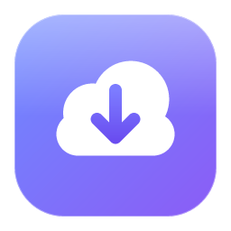

  

<h1 align="center">Nimbo</h1>

Gerenciador de downloads leve e rápido para Windows, com visual liquid glass.

  <a href="../../releases/latest"><b>⬇ Baixar a versão mais nova</b></a>

---

Este repositório guarda os **instaladores** do Nimbo. O próprio Nimbo procura aqui as versões
novas e se atualiza sozinho, e ele só aceita instaladores assinados com a chave dele.

## O que ele faz

- **Várias conexões por arquivo**: cada download é dividido em partes que baixam em paralelo, e
  a barra de progresso mostra cada parte enchendo.
- **Retoma de onde parou**: pausa, queda de internet ou PC desligado não fazem perder o que já veio.
- **Vídeo e música**: YouTube e mais de 1.800 sites, em MP4 na qualidade escolhida ou só o áudio
  (MP3, M4A, OPUS, FLAC). Dá para baixar só um trecho.
- **Extensão para o Firefox e o Chrome**: os downloads do navegador vão direto para o Nimbo.
- **Organização**: categorias (inclusive as suas), filas com horário e limite próprios, prioridade.
- **Ferramentas**: cortar MP3/MP4 com forma de onda, converter, diminuir para caber em X MB, ZIP.
- **Leve**: instalador de ~4 MB, cerca de 30 a 40 MB de memória.

## Instalar

1. Baixe o `Nimbo_x.y.z_x64-setup.exe` na [última versão](../../releases/latest).
2. Abra o arquivo. Não precisa de administrador.
3. O Windows pode avisar que o editor é desconhecido (o instalador não tem certificado pago):
   clique em **Mais informações → Executar assim mesmo**.

Windows 10 e 11, 64 bits.
