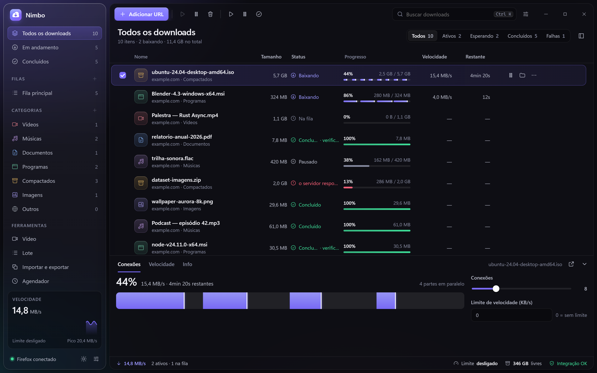
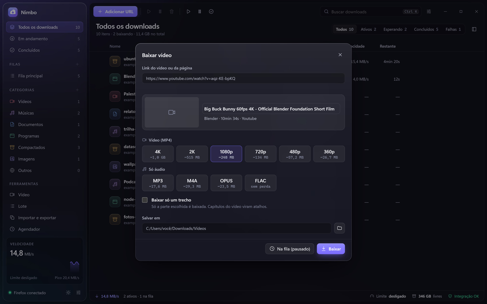
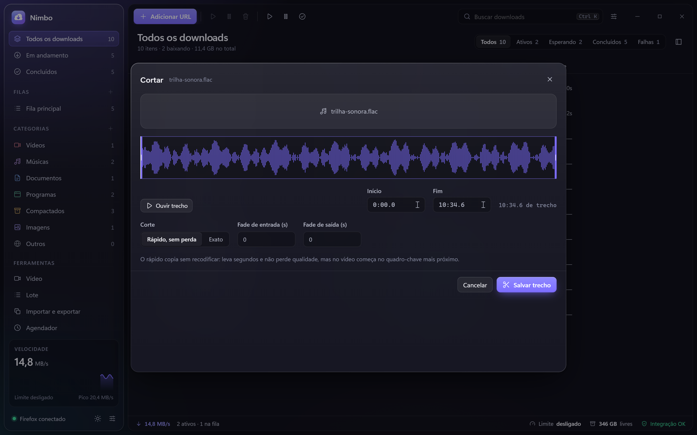
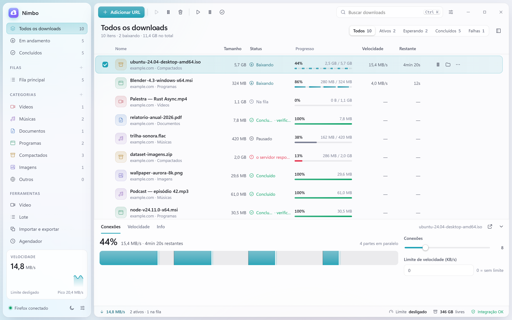
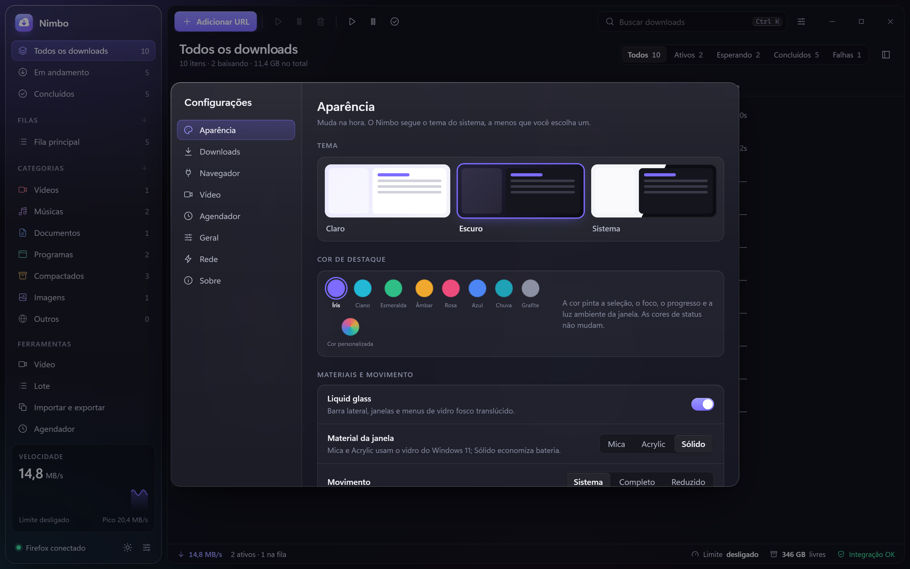
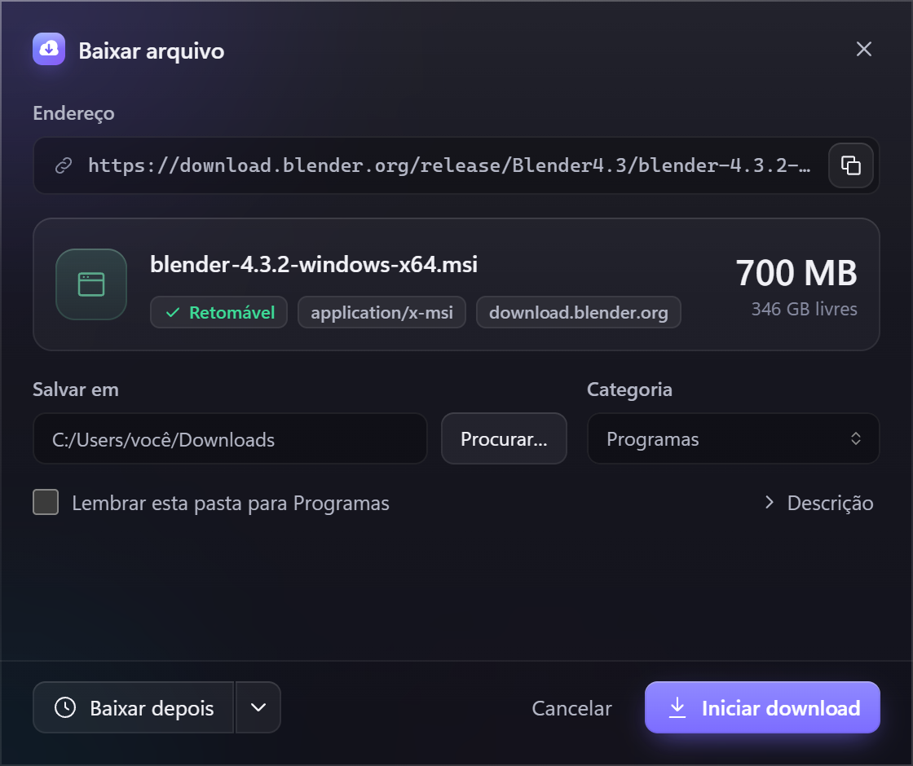
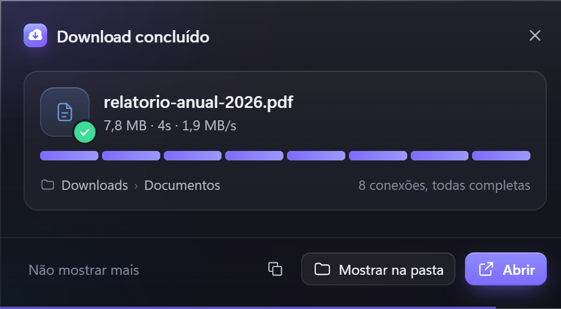

  

<h1 align="center">Nimbo</h1>

  Gerenciador de downloads para Windows, feito em Rust. 
  Várias conexões por arquivo, vídeo e música de mais de 1.800 sites, extensão para o navegador e visual liquid glass.

  <a href="../../releases/latest"><b>⬇ Baixar a versão mais nova</b></a>
  &nbsp;·&nbsp;
  <a href="#instalar">Instalar</a>
  &nbsp;·&nbsp;
  <a href="#extensão-do-navegador">Extensão</a>
  &nbsp;·&nbsp;
  <a href="#perguntas-frequentes">Perguntas</a>

  

## Por que o Nimbo

- **Rápido de verdade.** Cada arquivo é dividido em partes que baixam ao mesmo tempo. Quando uma parte
  termina, ela rouba trabalho da mais lenta, então o download não fica preso esperando a última conexão.
- **Não perde nada.** Pausa, queda de internet, PC desligado ou o Nimbo fechado à força: ele retoma de onde
  parou e confere com o servidor se o arquivo ainda é o mesmo.
- **Leve.** Instalador de ~4 MB, cerca de 40 MB de memória. Nada de Electron.
- **Seu.** Sem conta, sem anúncio, sem telemetria. Nada sai do seu PC além dos próprios downloads.

## O que ele faz

### Downloads

- Até 32 conexões por arquivo, com o limite certo aprendido para cada site
- Barra de progresso que mostra cada parte enchendo
- Filas com horário próprio, limite de velocidade compartilhado e quantos baixam ao mesmo tempo
- Prioridade alta, normal e baixa; limite global ou por download
- Categorias automáticas (vídeos, músicas, documentos, programas…) e categorias suas, com pasta e extensões
- Confere o hash (SHA-256, SHA-1, MD5) e pode passar o arquivo pelo Microsoft Defender ao terminar
- Links em lote (`arquivo[01-20].zip`), colar vários links de uma vez, importar e exportar a lista
- Agendador e ações ao terminar: desligar, suspender ou fechar o Nimbo

### Vídeo e música

- YouTube e mais de 1.800 sites, na qualidade que você escolher, de 360p a 4K
- Só o áudio em MP3, M4A, OPUS ou FLAC
- Baixar só um trecho, com os capítulos do vídeo como atalhos
- Legendas, MP4 ou MKV, preferência por H.264 para tocar em qualquer lugar
- Transmissões HLS (`.m3u8`), inclusive as criptografadas com AES-128
- yt-dlp, FFmpeg e Deno são baixados e atualizados sozinhos, com o hash conferido

### Ferramentas

- **Cortar** MP3 e MP4 na forma de onda, com fade de entrada e de saída; corte rápido sem perda ou exato
- **Converter** entre formatos de vídeo e áudio
- **Diminuir** um vídeo para caber em X MB
- **Compactar** em ZIP

### Visual

- Liquid glass, com Mica ou Acrylic do Windows 11
- Tema claro, escuro ou o do sistema
- Oito cores de destaque ou uma cor sua
- Ícones reais dos arquivos, como no Explorer
- Janela que se ajeita de 600 px até tela cheia
- Português e inglês

## Extensão do navegador

Com a extensão, o que você baixa no Firefox, Chrome, Edge ou Brave vai direto para o Nimbo, com cookies e tudo,
então funciona também em sites que pedem login.

  
  &nbsp;
  

- Pega os downloads do navegador e abre a janela de confirmação, ou baixa direto
- Botão direito em um link, imagem ou vídeo → **Baixar com o Nimbo**
- Encontra os vídeos e as transmissões da página
- Pareamento na primeira vez: só a sua extensão fala com o Nimbo

**Firefox:** Configurações do Nimbo → Navegador → *Instalar no Firefox*. A extensão é assinada pela Mozilla.

**Chrome, Edge, Brave e Vivaldi:** Configurações do Nimbo → Navegador → *Abrir no Chrome* (ou no seu navegador).
Abrem a página de extensões e a pasta da extensão; ligue o *Modo do desenvolvedor* e arraste a pasta para a página.
Quem não usa o Nimbo instalado pode baixar a extensão sozinha, o `Nimbo_x.y.z_chrome-extension.zip`, descompactar e
fazer o mesmo com a pasta.

## Instalar

Escolha um na [última versão](../../releases/latest):

| Arquivo | Para quem |
|---|---|
| `Nimbo_x.y.z_x64-setup.exe` | A maioria. Instala só para o seu usuário, sem pedir administrador, e se atualiza sozinho. |
| `Nimbo_x.y.z_x64-portable.zip` | Quem quer levar num pendrive. Descompacte e abra o `nimbo.exe`: tudo fica na pasta `data` ao lado dele. |
| `Nimbo_x.y.z_chrome-extension.zip` | Só a extensão para Chrome, Edge, Brave e Vivaldi (o instalador e o portátil já trazem ela). |

O Windows pode avisar que o editor é desconhecido, porque o instalador não tem um certificado pago.
Clique em **Mais informações → Executar assim mesmo**.

Windows 10 e 11, 64 bits.

## Atualizações

O Nimbo procura versões novas neste repositório e mostra um aviso quando há uma. Ele só instala
atualizações assinadas com a chave do projeto, então um arquivo trocado no meio do caminho é recusado.
A versão portátil avisa e abre esta página para você baixar.

## Privacidade e segurança

- Sem conta, sem telemetria, sem anúncios
- A conversa com a extensão fica no próprio PC (`127.0.0.1`), aceita só a extensão pareada e recusa páginas da web
- [Política de privacidade completa](PRIVACY.md)
- As ferramentas externas (yt-dlp, FFmpeg, Deno) vêm dos repositórios oficiais e têm o SHA-256 conferido antes de serem usadas

## Perguntas frequentes

**Ele é grátis?** Sim.

**Funciona com sites que pedem login?** Pela extensão, sim: ela entrega os cookies do site junto com o link.

**Onde ficam as configurações?** No instalado, em `%APPDATA%\app.nimbo.downloads`. No portátil, na pasta `data`.

**Como desinstalo?** Em Configurações do Windows → Aplicativos, como qualquer outro programa.

**Achei um problema.** Abra uma [issue](../../issues) contando o que aconteceu e o link, se puder.
